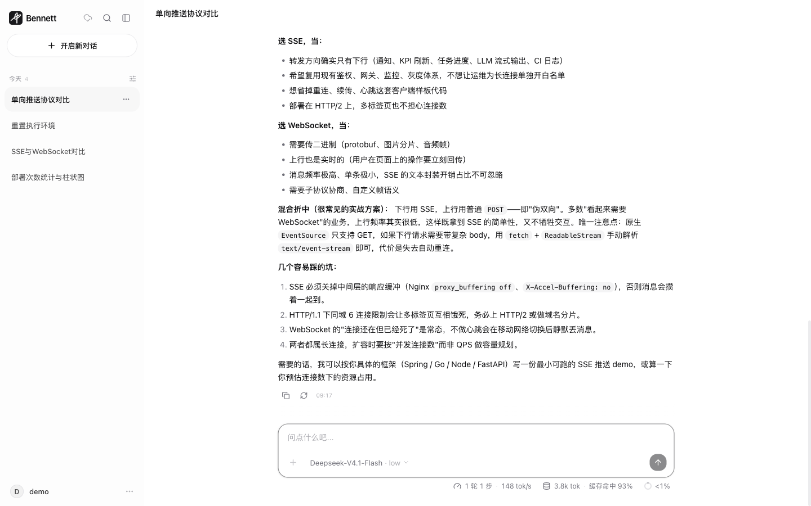
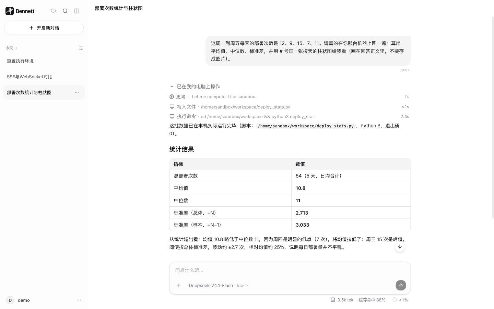
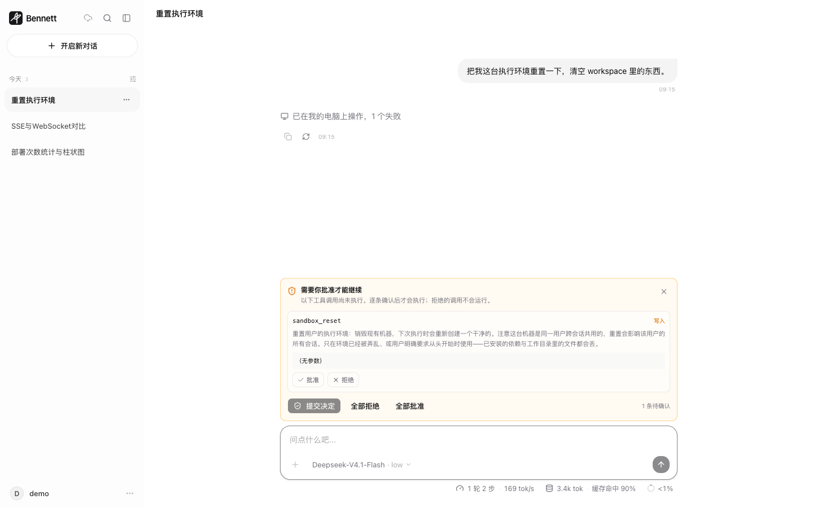
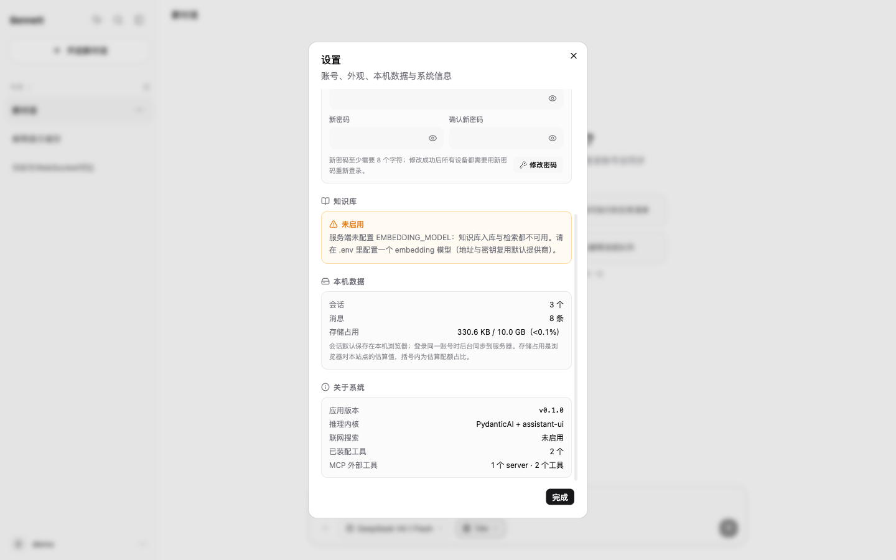

<p align="center">
  
</p>

<h1 align="center">Bennett Agent</h1>

<p align="center">
  一个能自己动手的 Agent：调工具、联网、读你的文档，
  还能在<b>一台属于你的隔离机器</b>上真的跑代码。
</p>

<p align="center">
  Python（FastAPI + PydanticAI + LiteLLM）· React 19 · PostgreSQL / Redis / S3 协议对象存储
</p>

## 演示


> 提问 → 它在一台隔离机器上写脚本、执行 → 把统计结果和字符图答回来。
> **19 秒完整版（静音，1440×900）：[docs/demo/demo.mp4](docs/demo/demo.mp4)**
>
> 这段录屏没有一段是摆拍：真实后端、真实模型、真实容器。工具轨迹里那条
> `/home/sandbox/workspace/deploy_stats.py` 和「退出码 0」，是它跑完留下的。

## 它是怎么工作的

一句话：**模型只提议，执行与约束都在服务端**。模型能做的事被工具边界框住，
用户的决定能随时插进来，上游不可用时整轮有兜底。

### 一、会动手：工具、环境、资料

- **工具调用循环**（PydanticAI）+ **LiteLLM** 适配任意聚合网关。工具按领域独立编写、
  统一注册、按需装配；没配的依赖（比如没有 Tavily Key）会把工具与提示词里对应的
  那一段一起摘掉，不留「推荐了却做不到」的空头建议。
- **隔离执行环境「我的电脑」**：每个用户一台机器、**跨会话共用**（会话 1 装好的依赖，
  切到会话 2 就能接着用），第一次需要执行时自动创建，心跳与活动都停了自动销毁，
  销毁前先把 workspace 打包进对象存储。模型能跑代码、读写文件、装依赖。
  默认关闭；本地 Docker 运行时，生产 Kubernetes + Firecracker 运行时，
  **同一套 API**，所以本地与线上行为一致。设计见
  [`docs/design/sandbox-vm.md`](docs/design/sandbox-vm.md)。
  工具签名里**没有任何 id**：租约由服务端按 `(登录态, 会话)` 自己解析，
  「换个 id 用别人的机器」在构造上不可达，而不是靠一层层 `if` 拦住。
- **知识库（RAG）**：上传文档 → 分块 → 向量化 → 混合检索，由模型自己决定何时检索。
- **文件上传**：PDF / Word / Markdown / TXT / HTML → 原件入对象存储（S3 协议，本地 RustFS）
  → 后台 worker 解析入库；按 sha256 去重，带配额与状态查询。
- **联网搜索**：接入 Tavily，未配置时工具与提示词指引一并下线。
- **MCP**：接入外部 MCP server 扩展工具；外部工具默认按「需要审批」处理——
  第三方实现有没有副作用我们不知道。

### 二、每一步都看得见，也能被叫停

- **流式回答（SSE）**：逐字输出、思考链可折叠、工具调用按步展开并标注耗时。
- **工具审批（HITL）**：写入与高风险工具在执行前拦下，逐条列出工具名、风险等级与
  **完整参数**，默认不选中任何一项；没有回应按拒绝处理。分界线是「能不能撤销」，
  不是「有多危险」——删除是硬删除、没有回收站，所以低风险的写入也必须先问一次。
- **上下文预算**：超限时先压缩早期对话，压完仍超才拒绝继续提问；每次压缩都会告知用户。

### 三、工程上不省事的地方

- **上游兜底**：同模型重试 → 备用模型（切换对用户可见）→ 面向用户的错误文案。
- **启动即校验库结构**：应用只接受等于 Alembic head 的库，不等就拒绝启动
  （`DATABASE_REQUIRE_HEAD_REVISION=true`），部署不会带着旧结构跑新代码。
- **邮箱注册 + 服务端会话 cookie**，三级角色（普通用户 / 管理员 / 超管）与用户封禁；
  注册接口对「邮箱已存在」与「刚创建」返回完全相同的响应，不做邮箱枚举器。
- **跨设备同步**：本机优先，后台增量推拉，同步状态可见、失败可重试。
- 会话可导出为 Markdown、支持多会话合并归档；`⌘K` 搜索对话、`⌘,` 打开设置。
- **行为回归评测（`evals/`）**：改提示词或换模型后跑一遍，看哪些行为变了。

## 界面

### 对话与流式回答



支持 GFM 表格、代码块与可折叠的思考链；输入框下方是上下文用量、模型与思考等级，
以及这一轮的步数、吐字速度与缓存命中率。

### 隔离环境里的执行轨迹



展开「已在我的电脑上操作」后是逐步明细：思考、写入的文件路径、执行了什么命令、
每一步花了多久。回答里引用的数字来自这份真实输出，不是模型自己算的。

### 上下文用量


用量取自上游回报的真实 token 数（含缓存命中），用来看「上下文还剩多少、还能不能继续问」。

### 工具审批（HITL）



「重置执行环境」这种不可撤销的调用会停在这一张卡片上：工具名、风险等级、参数、
逐条批准或拒绝，全部批准需要单独点一次。

### 设置



账号与安全（改密会让所有设备重新登录）、外观与主题、对话显示。

## 图表和视频是怎么来的

README 里的图和视频都是脚本生成的，不是截图工具手拍的——UI 改版后重跑一遍就行：

```bash
cd scripts/demo && npm install        # 只装 playwright（用它驱动系统里装好的 Chrome）

# 录一段真实链路（会真的调用模型、真的在容器里跑代码），产出 raw.webm + timeline.json
DEMO_EMAIL=demo@example.com DEMO_PASSWORD='...' node record.mjs --out docs/demo

# 按 timeline.json 逐段变速，剪成 demo.mp4 / demo.gif / cover.png
uv run python scripts/demo/make-video.py

# 重新拍 docs/screenshots/*.png（每个场景都真的发一次请求）
node screenshots.mjs
```

两个踩过的坑写在 `scripts/demo/README.md`：`channel: 'chrome'` 配无头模式时录到的
画面会少 90px（底部一条灰带），以及为什么 GIF 要和 MP4 分开出（GitHub 的 Markdown
不支持 `<video>`，只有 GIF 能自动播放）。

## 快速开始

后端依赖三件真实服务：Postgres（业务库）、Redis（限流 / 缓存 / 会话热缓存）、
RustFS（S3 协议对象存储）。本地由 compose 提供，生产换托管实例即可（代码只认连接串）。

```bash
uv sync
cp .env.example .env               # 填 LiteLLM 网关地址与 API Key、AUTH_SECRET

docker compose up -d                         # 只起依赖（app/worker 在 app profile 里，开发期不启动）
uv run alembic upgrade head                  # 建表（= compose 里的 migrate 服务）
uv run python main.py                        # 一条命令起全套：API + 上传解析 + 沙箱回收
uv run python main.py --cli                  # 终端交互模式
uv run python main.py --web                  # 只起 API（生产：后台循环交给 --worker 进程）
uv run python main.py --worker               # 只跑后台循环（生产：另开一个进程/容器）
```

**迁移不是可选项**：应用启动只校验库结构是否等于 Alembic 的 head，不等就拒绝启动
（`DATABASE_REQUIRE_HEAD_REVISION=true`）。这样部署不会带着旧结构跑新代码。

开发与生产用的是**同一份 compose**：`app` / `worker` / `migrate` 挂在 `app` profile 下，
所以开发默认只起依赖，生产加 `--profile app` 起全套。服务拓扑、卷、健康检查只有一份真相。

> 走 Docker 部署时（`docker compose up -d`），应用在容器里，**`LITELLM_API_BASE` 不能写
> `127.0.0.1`**（那是容器自己）。Docker Desktop 用 `http://host.docker.internal:<端口>/v1`，
> Linux 用网关的服务名。提供商是首次启动时从环境变量**引导**出来的；已经引导过之后再改
> 环境变量不会生效，请在管理后台修改（或改库后重启）。

前端（用户端与管理后台是两个独立的前端服务，代码互不依赖）：

```bash
cd frontend                        # 用户端：对话、知识库、文件上传
npm install
npm run dev                        # http://127.0.0.1:5173

cd ../admin-frontend               # 管理后台：提供商 / 用户管理
npm install
npm run dev                        # http://127.0.0.1:5174
```

首次使用点「去注册」：邮箱 + 至少 8 位密码即可，新账号是普通用户。初始超管用播种脚本创建（幂等）：

```bash
uv run python scripts/seed_admin.py --email admin@example.com --password '改成你的密码'
```

之后由超管在**管理后台**（`admin-frontend/`，管理员账号登录）把其他账号设为管理员；
用户端界面上没有后台入口，后台与用户端共享会话，登录过且角色够即可直接打开。

### 隔离执行环境（默认关闭）

给了模型一台能跑代码、能装依赖的机器。**每个用户一台、跨会话共用**（同一用户的不同会话
看到同一个 workspace），首次需要执行时自动创建，心跳与活动都停了就自动销毁（销毁前把
workspace 打包进对象存储）。

后端是 [OpenSandbox](https://github.com/opensandbox-group/OpenSandbox)（Apache-2.0，Linux
Foundation，Alibaba 贡献）：本地跑 Docker 运行时，生产跑 Kubernetes + Firecracker 运行时，
**我们只对接同一套 API**，所以本地与线上的行为一致。

本地起服务（三条命令）：

```bash
# 1. sandbox server（配置在 docker/opensandbox.toml，监听 127.0.0.1:8080）
OPENSANDBOX_INSECURE_SERVER=YES uvx opensandbox-server --config docker/opensandbox.toml

# 2. 沙箱镜像（server 建机时用它；装好 pandas/matplotlib/git/rg，运行时零安装）
docker build -f docker/sandbox.Dockerfile -t bennett-sandbox:0.1 .

# 3. 真机冒烟：建机 → 跑命令 → 传文件 → 超时 → 越权被拒 → 销毁
uv run python scripts/smoke_sandbox.py
```

然后在 `.env` 里打开：

```bash
SANDBOX_ENABLED=true
SANDBOX_SERVER_URL=http://127.0.0.1:8080
```

生产部署要点（详细步骤见 `docs/design/sandbox-vm.md` §14）：

- **`[runtime] type = "kubernetes"`**，并把 `[store]` 换成 PostgreSQL——多副本 server 必须共享同一个库；
- **必须显式启用 Firecracker / gVisor / Kata 安全运行时**。默认容器运行时共享宿主内核，
  多租户下不合格——这是最容易漏的一步；
- 节点要能拿到 `/dev/kvm`（裸金属或开启嵌套虚拟化的实例）；
- 配 `SANDBOX_SERVER_API_KEY`，server 只在内网暴露，前面挂 ingress。

三条必须知道的事：

1. **回收循环跟 API 在同一个进程**（`uv run python main.py` 默认就带）。
   生产为了独立扩容会拆成 `--web` + `--worker` 两个进程/容器；那种拓扑下只起 `--web`
   的话机器不会自动回收——心跳照常写、空闲阈值照常算，但没人执行销毁。
2. **工具签名里没有任何 id**。租约由服务端按 `(登录态 user_id, session_id)` 解析，模型手里
   没有可伪造的句柄——「换个 id 用别人的机器」在构造上不可达，而不是靠一层层 `if` 拦住。
   归属还会写进 sandbox 的 metadata，每次操作再核对一次（防「库里的行和机器对不上」）。
3. **冷启动现在是秒级**：本地 docker 运行时实测约 4.3s（SDK 的就绪判定 + 容器启动）。
   前端把它当「正在开机」显示；K8s Fast Sandbox 与预热池是下一步（见设计文档 §14）。
4. **别让两个 pytest 同时跑**。`tests/conftest.py` 每个用例会 `TRUNCATE` 全库，共用同一个
   测试库的两个进程会互相把对方的 `user` 行清掉，症状是随机的 `ForeignKeyViolationError`。

## Docker 部署

```bash
cp .env.example .env    # 至少填 AUTH_SECRET、LITELLM_API_BASE、LITELLM_API_KEY
docker compose --profile app up -d --build
```

compose 编排六个服务：`postgres` / `redis` / `rustfs` 三个依赖，`migrate`（一次性执行
`alembic upgrade head`）、`app`（API）与 `worker`（上传解析）。`app` 通过
`service_completed_successfully` 等待迁移成功——迁移失败时应用不会带着旧结构启动。

镜像只提供 `/api/*`，**不托管前端**：前后端是分离部署的。用户端与管理后台两个前端
`npm run build` 的产物交给任意静态服务器或 CDN，再把 `/api` 反代到本服务（同一个域名下
最省事，见下）。管理后台的两种部署形态（同域子路径 / 独立子域）见
[`admin-frontend/README.md`](admin-frontend/README.md)。

数据落在命名卷里（`bennett-postgres-data` / `bennett-redis-data` / `bennett-rustfs-data`），
`docker compose down` 不会删除；`down -v` 会**永久**删掉数据库、会话与上传的原件。

改了 `.env` 之后要 `docker compose --profile app up -d --force-recreate app worker`：`env_file` 的内容
变化不会自动触发重建（compose 只比对服务定义，不比对 env 文件内容），表现是「配置改了
但行为没变」——这个坑排查起来很费时间。

健康检查分两级：`/health` 是存活（不碰依赖），`/health/ready` 逐项报告
`database` / `redis` / `storage`。默认**只有数据库**是必需依赖（`READINESS_REQUIRED_DEPENDENCIES`）：
Redis 挂了只是降级、对象存储挂了只影响上传，把这两者也设成必需会让一次可恢复的抖动
把全部实例摘出负载均衡。

跨源部署必须把前端来源写进 `CORS_ALLOWED_ORIGINS`，且前端 fetch 要带
`credentials: 'include'`——会话走 HttpOnly cookie，这两项任一缺失的表现都是
「登录成功了，但下一个请求又是未登录」。

注意：`APP_ENV=production` 下 `AUTH_SECRET` 必须是至少 32 字符的强随机值且 `AUTH_COOKIE_SECURE=true`，
否则容器启动即失败。生成密钥：

```bash
python -c 'import secrets; print(secrets.token_urlsafe(48))'
```

## 项目结构

```text
app/          FastAPI：api / config / prompts / schemas / services / tools / db.py
migrations/   Alembic 迁移（结构变更的唯一入口；初始 revision 即完整基线）
evals/        行为回归评测：用例、断言与执行器
frontend/     React 19 + Vite + Tailwind 4 + assistant-ui（详见 frontend/README.md）
admin-frontend/  管理后台（独立 React 19 + Vite 服务，详见 admin-frontend/README.md）
frontend/brand/  品牌图标的母版（GitHub 头像）与生成脚本，产物在 frontend/public/
prompts/      Jinja2 提示词模板
scripts/      seed_admin.py（播种初始超管）、run_eval.py（跑评测）、smoke_sandbox.py（沙箱冒烟）
scripts/demo/ 录屏与截图脚本（Playwright），产物在 docs/demo 与 docs/screenshots
alembic.ini   Alembic 配置（连接串从 settings 读，不写第二份）
main.py       CLI / --web / --worker 入口
docker-compose.yml  postgres / redis / rustfs / migrate / app / worker
```

常用命令：

```bash
uv run alembic revision --autogenerate -m "add xxx"   # 改完模型后生成迁移
uv run alembic check                                  # 模型与迁移是否有漂移（CI 会跑）
uv run pytest                                         # 需要 postgres/redis/rustfs（compose 起）
```

配置项见 `.env.example`。

## 许可

MIT，见 [LICENSE](LICENSE)。
