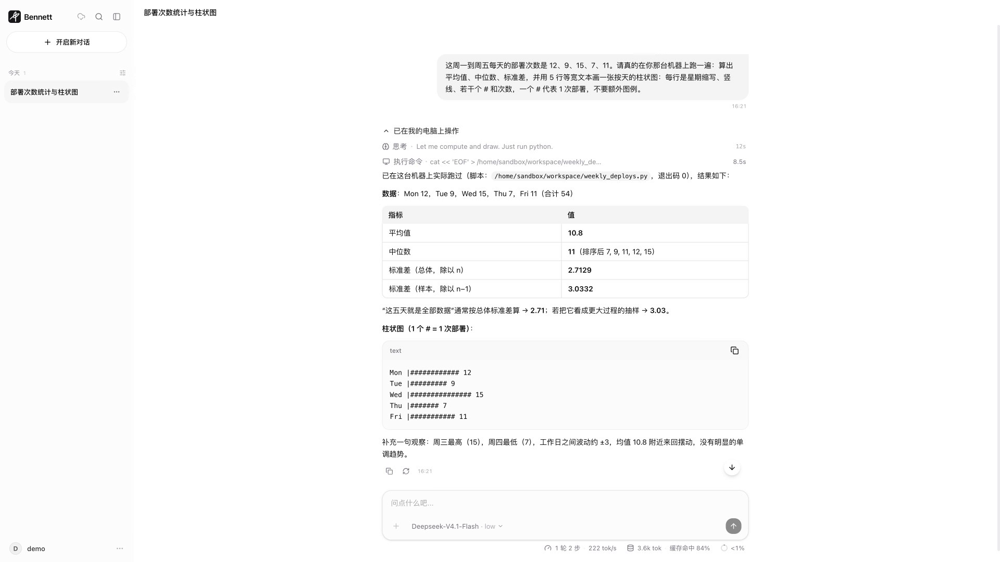
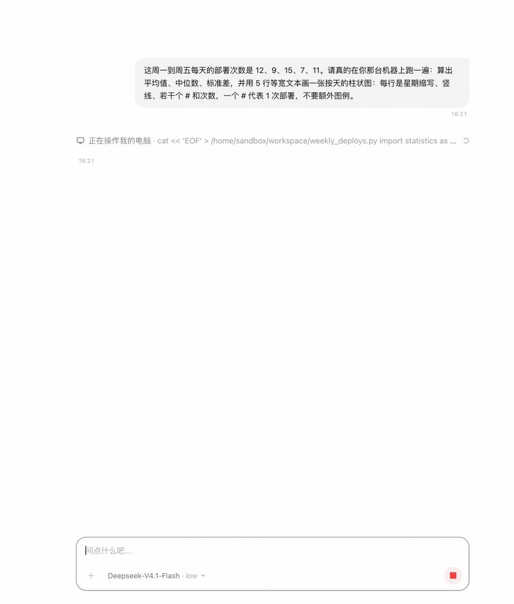
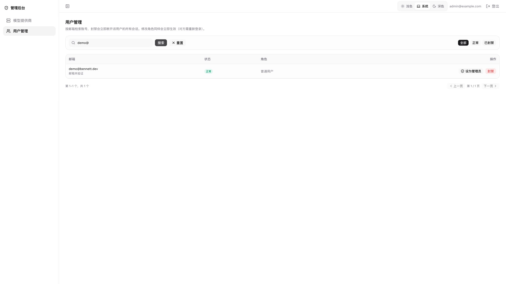

# Bennett Agent

自托管的多租户 AI 对话助手平台：基于 [PydanticAI](https://ai.pydantic.dev/) + [LiteLLM](https://docs.litellm.ai/) 的 Agent 框架，FastAPI SSE 流式后端，React 19 前端，配独立管理后台。

## 演示

**用户端**（63 秒，1920×1080，无声）：换模型 → 提问 → 模型在自己的沙箱里写脚本、执行、贴回真实输出 → 展开工具轨迹看路径/退出码/每步耗时 → 查上下文预算 → 追问确认工作区还在。全程真实链路，没有一幕是剪辑出来的。

[](https://ruanbw.github.io/bennett-agent/)

点封面进 **[播放页](https://ruanbw.github.io/bennett-agent/)**（GitHub Pages）：原生 `<video>`、1080p 原画、可拖进度条与全屏，两段片子都带章节按钮。

为什么不直接链仓库里的 mp4：GitHub 的 blob 页对它只给「View raw」（不播放），而 `raw.githubusercontent.com` 返回 `application/octet-stream` + `nosniff`，README 里的 `<video>` 也解不出来。Pages 返回的是 `video/mp4`，所以能播。

下面这段是 **GIF 自动播放预览**，不点任何东西就能看个大概（代价是 880 宽、9fps，正文文字能读但不如 MP4 锐）：



**管理端 + 后端**（43 秒，1920×1080，无声）：提供商与模型清单（同步、启停、设默认）→ 用户与角色 → `/docs` 的 OpenAPI 接口面 → 就绪探针逐项依赖状态 → Prometheus 指标。

[](https://ruanbw.github.io/bennett-agent/#admin)

物料由 `scripts/demo/` 下的脚本产出（Playwright 录真实浏览器 + ffmpeg 按时间轴变速剪辑），重录步骤见 [scripts/demo/README.md](scripts/demo/README.md)。仓库里的 `docs/demo/*.mp4` 是同一份文件的可下载原件。

## 功能特性

- **多提供商模型接入**：所有提供商统一走 OpenAI 兼容端点 + LiteLLM 路由格式（如 `openai/gpt-4o`）。管理后台内置主流厂商预设（OpenAI、Anthropic、Google、DeepSeek、Kimi、通义千问、智谱、OpenRouter、Groq、xAI、硅基流动、火山方舟等），也支持 Ollama / LM Studio 本地模型；API Key 加密落库，首次启动可由环境变量引导。
- **Agent 工具**：联网搜索（Tavily）、沙箱代码执行、澄清提问，以及通过 MCP 动态发现的外部工具（http 与 stdio 两种传输）。
- **沙箱执行**：每用户一台隔离执行环境（[OpenSandbox](https://github.com/opencode-ai/opensandbox)，本地 Docker 运行时 / 生产 K8s + Firecracker），心跳续命 + 自动回收。
- **上下文预算**：每轮生成前估算 token 用量，超限自动两级压缩（截断超长单条 → 折叠旧轮次为摘要），压缩对用户可见；也支持直接拒绝或不设防。
- **模型容灾**：主模型返回 5xx / 429 / 超时时自动切换备用模型重试。
- **本地优先前端**：会话数据存 IndexedDB，断网不会丢已同步的内容；通过增量同步引擎（push 行级 upsert / pull 游标长轮询）与服务端保持一致。**注意：进入应用本身需要联网**——启动时要调 `/api/auth/me` 确认登录态，断网会停在登录页（目前没有 Service Worker）。
- **多租户与 RBAC**：HttpOnly Cookie 会话认证，`user` / `admin` / `superadmin` 三档角色；管理后台可维护提供商、模型与用户。

## 仓库结构

```
bennett-agent/
├── main.py             # 运行入口（默认起 API + 沙箱回收；--reload 仅开发用）
├── app/                # 后端源码（api/ services/ tools/ config/ db.py）
├── sql/                # 建库脚本 init.sql（唯一事实来源）
├── prompts/            # 系统提示词模板（Jinja2）
├── frontend/           # 用户端（React 19 + Vite，dev 端口 5173）
├── admin-frontend/     # 管理后台（React 19 + Vite + react-router，dev 端口 5174）
├── evals/              # 行为回归评测用例与框架
├── scripts/            # 运维 / 评测脚本
├── tests/              # pytest 测试
├── docker/             # 沙箱镜像与 OpenSandbox 本地配置
├── Dockerfile          # 后端镜像（前端是独立静态产物，不在其中）
└── docker-compose.yml  # 开发依赖 + 生产编排（app profile）
```

## 技术栈

| 层 | 技术 |
|---|---|
| 后端 | Python 3.10+、FastAPI、PydanticAI、LiteLLM、SQLAlchemy (asyncpg)、uv |
| 前端 | React 19、Vite、TypeScript、Tailwind CSS 4、zustand、Dexie (IndexedDB) |
| 数据层 | PostgreSQL 17、Redis 7（限流 / 缓存 / 会话热缓存）、S3 协议对象存储（RustFS / AWS S3 / OSS） |
| 沙箱 | OpenSandbox（本地 Docker 运行时） |

## 快速开始（本地开发）

前置要求：Docker、[uv](https://docs.astral.sh/uv/)、Node.js >= 20.11。

```bash
# 1. 起依赖服务（PostgreSQL / Redis / RustFS 对象存储）
docker compose up -d

# 2. 后端
cp .env.example .env        # 至少填 AUTH_SECRET / LITELLM_API_BASE / LITELLM_API_KEY
uv sync
uv run python main.py --reload   # http://127.0.0.1:8000（开发模式下 /docs 可用）

# 3. 用户端前端
cd frontend && npm install && npm run dev    # http://localhost:5173，/api 代理到 8000

# 4. 管理后台（可选）
cd admin-frontend && npm install && npm run dev    # http://localhost:5174
```

创建初始超级管理员（账号不存在则创建，`--promote` 提升已有账号，`--force-reset` 重置密码）：

```bash
uv run python scripts/seed_admin.py --email admin@example.com
```

默认监听 `127.0.0.1`：注册入口开放，需局域网访问时用 `--host 0.0.0.0` 显式放开。

## 数据库结构

结构只有一处真相：`sql/init.sql`。整段幂等，应用启动时执行一次（多实例并发启动也安全）。
不维护增量迁移——改表就直接改脚本，然后重建开发库：

```bash
docker compose down -v && docker compose up -d postgres
```

改完跑 `uv run pytest tests/test_db_schema.py`，它会检查模型与脚本是否漂移。

### 启用沙箱（可选）

默认关闭。本地开发用 Docker 运行时：

```bash
docker build -f docker/sandbox.Dockerfile -t bennett-sandbox:0.1 docker/
uvx opensandbox-server --config docker/opensandbox.toml
# 再在 .env 里设置 SANDBOX_ENABLED=true
```

## 生产部署

```bash
cp .env.example .env    # 填生产值（AUTH_SECRET 为占位值时拒绝启动）
docker compose --profile app up -d --build
docker compose logs -f app
```

`app` profile 会启动 `app`（FastAPI，启动时执行 `sql/init.sql` 建表，并在同一进程里跑沙箱空闲回收）。前端是独立静态产物，`npm run build` 后交由静态服务器 / CDN 托管，不在 compose 内。

所有服务端口只绑定回环地址；数据库与 Redis 无额外防护，远程访问请走 SSH 隧道或带 TLS 的反向代理。`docker compose down -v` 会删除全部数据（含对象存储里的沙箱产物），不可恢复。

## 配置

全部配置项带中文注释，见 [.env.example](.env.example)。主要分组：

| 分组 | 说明 |
|---|---|
| 应用基础 | `APP_ENV`、`ASSISTANT_NAME`、`ENABLE_API_DOCS`、日志级别 |
| 模型网关 | `LITELLM_API_BASE/KEY`、`MODEL_NAME`、备用模型、上游超时、出站 SSRF 防护 |
| 上下文预算 | `CONTEXT_GUARD_MODE`（compact / reject / off）与两级压缩参数 |
| 工具 | `TAVILY_API_KEY`、`MCP_SERVERS`、MCP 工具超时 |
| 数据库 / Redis | 连接串、连接池、会话缓存开关 |
| 对象存储 | S3 端点 / 凭据 / 桶（RustFS、AWS S3、OSS 同一套 API） |
| 认证 | `AUTH_SECRET`（兼提供商 API Key 加密密钥）、Cookie 与会话策略 |
| 限流 | 按账号的对话限流、按 IP 的认证限流、可信代理 |
| 沙箱 | 开关、运行时、资源配额、生命周期、容量上限、出网策略 |

## 测试与代码质量

```bash
# 后端测试（需要先起依赖服务；测试库 / 桶由测试基座自动准备）
docker compose up -d postgres redis rustfs
uv run pytest

# Lint 与格式检查（CI 同款）
uv run ruff check .
uv run ruff format --check .

# 前端
cd frontend && npm run lint && npm run test && npm run build
```

CI（GitHub Actions）：后端跑 ruff、结构漂移检测、pytest；前端跑 lint、类型检查、测试与构建。

## 行为回归评测

`evals/` 定义用例（断言工具调用序列、必含 / 禁含短语、澄清选项数等），`scripts/run_eval.py` 走生产对话链路执行，可按 tag / model / baseline 过滤对比。注意会真实调用上游模型、产生费用，不在 CI 中运行：

```bash
uv run python scripts/run_eval.py
```

## 常用脚本

| 脚本 | 用途 |
|---|---|
| `scripts/seed_admin.py` | 幂等播种超级管理员 |
| `scripts/run_eval.py` | 行为回归评测 |
| `scripts/smoke_sandbox.py` | 沙箱端到端冒烟（建机 / 执行 / 传文件 / 销毁） |

## 运维端点

- `GET /health`、`GET /health/ready` — 存活 / 就绪探针
- `GET /api/metrics` — Prometheus 指标（`METRICS_ENABLED` 开启）

## License

[MIT](LICENSE)
